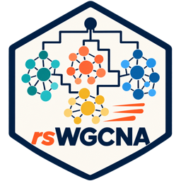

<p align="center"></p>

# rsWGCNA Dashboard

**An open, out-of-the-box web dashboard for weighted gene co-expression network analysis (WGCNA) — Go backend + Vue 3 frontend + Rust worker.**

[](README.zh-CN.md)
[](LICENSE)
[](https://go.dev)
[](https://vuejs.org)
[](https://github.com/XiaoWang-SXAU-Lab/rs-wgcna)
[](#build)

> A battery-included GUI for [`rs-wgcna`](https://github.com/XiaoWang-SXAU-Lab/rs-wgcna): upload data, tune parameters, and get publication-ready plots and tables — no R, no command line.

---

## Download / Install

Prebuilt desktop packages are published on the
[Releases](https://github.com/XiaoWang-SXAU-Lab/wgcna-dashboard/releases) page.
They bundle the R runtime used for publication exports, so **no separate R
installation is required**.

- **Windows** — `rsWGCNA-setup-0.5.0.exe`: a standard Inno Setup installer
  (no admin rights needed). Installs to `%LOCALAPPDATA%\rsWGCNA` with Start
  Menu / desktop shortcuts and an uninstaller. Win10/11's built-in WebView2 is
  used for the window.
- **macOS (Apple Silicon)** — `rsWGCNA-0.5.0.dmg`: open the disk image and drag
  `rsWGCNA.app` to Applications. The app is ad-hoc signed but not notarized, so on first
  launch Gatekeeper may block it — right-click (Control-click) the app and
  choose **Open**, or run: `xattr -cr /Applications/rsWGCNA.app`.

To build from source, see [Build](#build) below.

---

## Overview

`rsWGCNA Dashboard` is a **B/S (browser/server) application** that wraps the
pure-Rust [`rs-wgcna`](https://github.com/XiaoWang-SXAU-Lab/rs-wgcna) kernel in a
friendly web UI. It ships as a **single self-contained binary** (frontend assets
and the Rust worker are embedded), so users install nothing but the executable.

| Layer | Tech |
|---|---|
| Frontend | Vue 3 + Vite + ECharts + AG Grid + Bootstrap + Pinia + Vue Router |
| Backend | Go (REST API + job scheduling + file management + AI navigator) |
| Compute | Rust worker (`rs-wgcna-worker`) — the rs-wgcna kernel |

---

## Features

- **7-step pipeline**: import & QC → cleaning/filtering → soft-threshold β →
  network & modules → module–trait → module detail → hub genes.
- **Two run modes**:
  - *one-step* — run the whole pipeline in one click;
  - *step-by-step* — run per step; changing a parameter re-runs only that step
    and its downstream (dirty cascade), with cached results.
- **Interactive visualization**: ECharts dendrogram (module-colored sample tree),
  module–trait heatmap, GS/MM scatter, AG Grid gene tables; resize, recolor, and
  download PNG/SVG for every chart.
- **Publication-quality plots**: SFT and dendrogram render to PDF/SVG.
- **AI navigator**: multi-vendor LLM (OpenAI-compatible), local vector RAG over
  the codebase, encrypted API key, streaming rich-text Q&A, and one-click error
  diagnosis.
- **Data types & normalization**: FPKM/TPM (`log10(x+1)`), raw count
  (`vst (DESeq2)`, pure Rust), peak area (`log10(x)`), protein (`log2(x)`);
  accepts TSV/CSV/XLSX.
- **i18n**: English / 中文 toggle.

---

## Architecture

```
Web frontend (Vue3 + ECharts + AG Grid)
   │ HTTP / SSE
Go backend (API + job scheduling + files + AI navigator)
   │ spawn + progress/files
Rust worker (rs-wgcna-worker --job-dir --step)
```

The backend manages jobs under a `WGCNA_JOBS_DIR`, streams progress over SSE,
and spawns the embedded `rs-wgcna-worker` per step. The AI navigator answers
questions about the codebase and WGCNA principles via a local vector index.

---

## Project structure

```
wgcna-dashboard/
├── backend/             # Go backend (api / job / ai / plot / web / worker)
│   └── internal/...
├── frontend/            # Vue 3 frontend
│   └── src/views, components, stores, utils
├── schemas/             # JSON contracts (params / pipeline / results)
├── NEWS.md              # changelog
└── Makefile             # build tasks
```

---

## Build

Requires Node ≥ 22, pnpm, Go ≥ 1.24, and Rust (for the worker).

```bash
# Single binary — embeds the frontend and the Rust worker
make build            # -> ./wgcna-dashboard

# Or step by step
cd frontend && pnpm install && pnpm build          # frontend
cd ../rs_WGCNA && cargo build --release --bin rs-wgcna-worker   # worker
cd backend && go build -tags release ./cmd/server  # backend
```

Run:

```bash
WGCNA_JOBS_DIR=/tmp/wgcna-home ./wgcna-dashboard   # http://localhost:8080
```

---

## Roadmap

- [x] Full 7-step pipeline + one-step / step-by-step modes
- [x] AI navigator (LLM + RAG + error diagnosis)
- [x] Raw-count vst normalization (pure Rust)
- [ ] Drop the R plotting dependency (native Rust/SVG charts) for a fully
      self-contained, R-free DMG/EXE package
- [x] Desktop packaging (macOS `.dmg` / Windows installer `.exe`)

---

## Contributors

- [**Shawn Wang**](https://github.com/ShawnWx2019) — design & implementation
- [**DeepSeek**](https://github.com/deepseek-ai) — AI co-development

## License

[MIT](LICENSE) © 2026 Shawn Wang (Xiao Wang-SXAU-Lab) and contributors
