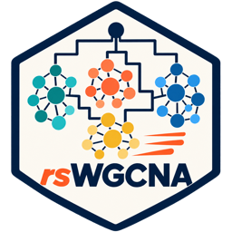

<p align="center"></p>

# rsWGCNA Dashboard

**An open, out-of-the-box web dashboard for weighted gene co-expression network analysis (WGCNA) — Go backend + Vue 3 frontend + Rust worker.**

[](README.zh-CN.md)
[](LICENSE)
[](https://go.dev)
[](https://vuejs.org)
[](https://github.com/XiaoWang-SXAU-Lab/rs-wgcna)
[](NEWS.md)

> A battery-included GUI for [`rs-wgcna`](https://github.com/XiaoWang-SXAU-Lab/rs-wgcna): upload data, tune parameters, and get interactive plots and result tables without using the command line. Some plots require the bundled R runtime.

> **Exploration branch note:** this branch (`explore/project-copilot`) includes
> unreleased project-workspace, candidate-priority, and evidence-interpretation
> work. The latest tagged stable release is **v0.6.0**; use the
> Releases page for production installers.

---

## Download / Install

Prebuilt desktop packages are published on the
[Releases](https://github.com/XiaoWang-SXAU-Lab/wgcna-dashboard/releases) page.
They bundle the R runtime used for publication exports, so **no separate R
installation is required**.

- **Windows** — `rsWGCNA-setup-0.6.0.exe`: a standard Inno Setup installer
  (no admin rights needed). Installs to `%LOCALAPPDATA%\rsWGCNA` with Start
  Menu / desktop shortcuts and an uninstaller. Win10/11's built-in WebView2 is
  used for the window.
- **macOS (Apple Silicon)** — `rsWGCNA-0.6.0.dmg`: open the disk image and drag
  `rsWGCNA.app` to Applications. The app is ad-hoc signed but not notarized, so on first
  launch Gatekeeper may block it — right-click (Control-click) the app and
  choose **Open**, or run: `xattr -cr /Applications/rsWGCNA.app`.

To build from source, see [Build](#build) below.

## Code signing policy

We have applied for Windows code signing through [SignPath Foundation](https://signpath.org/).
The application is pending. See the [code signing policy](CODE_SIGNING_POLICY.md)
for the planned release process. macOS builds use ad-hoc signing and are not
notarized by Apple.

---

## Overview

`rsWGCNA Dashboard` is a **B/S (browser/server) application** that wraps the
pure-Rust [`rs-wgcna`](https://github.com/XiaoWang-SXAU-Lab/rs-wgcna) kernel in a
friendly web UI. The frontend is embedded in **one Go executable**; the Rust
worker and ReguTrace scanner are installed as **sidecar executables** next to
it (never extracted from the app at runtime).

| Layer | Tech |
|---|---|
| Frontend | Vue 3 + Vite + ECharts + AG Grid + Bootstrap + Pinia + Vue Router |
| Backend | Go (REST API + job scheduling + file management + AI navigator) |
| Compute | Rust worker (`rs-wgcna-worker`) — the rs-wgcna kernel |

---

## Features

- **Project workspace + step-by-step pipeline**: create/open/recent projects,
  revisioned drafts and results, a project-level question card, and per-step
  provenance. The analysis path is import & QC → cleaning/filtering →
  soft-threshold β → network & modules → module–trait → module detail →
  candidate priority → report.
- **Two run modes**:
  - *step-by-step* — run per step; changing a parameter re-runs only that step
    and its downstream (dirty cascade), with cached results.
- **Candidate priority / evidence**: bootstrap stability of within-module
  kWithin ranks over a fixed full module, with valid/invalid round accounting,
  midrank/P05/P95, top-K frequency, annotated candidate tables, and explicit
  engineering-budget guards. Optional offline evidence interpretation is built
  from the server’s current atomic evidence envelope; no online model is
  required. These are connectivity-stability descriptions, not probabilities,
  trait associations, or causal hubs.
- **Interactive visualization**: ECharts dendrogram (module-colored sample tree),
  module–trait heatmap, GS/MM scatter, AG Grid gene tables; resize, recolor, and
  download PNG/SVG for every chart.
  In Module Explorer, expand **Edge stability (optional)** below the network
  to see how often selected edges exceed the TOM threshold in valid resamples.
- **ReguTrace TF–target prior**: full evidence export as SQLite/TSV/CSV/gzip/
  JSONL, optional Data Import prior upload, and a Module Explorer upstream-TF
  view. The ReguTrace toolkit remains independent of WGCNA project execution.
- **Publication-quality plots**: SFT and dendrogram render to PDF/SVG.
- **AI navigator**: multi-vendor LLM (OpenAI-compatible), local vector RAG over
  the codebase, encrypted API key, streaming rich-text Q&A, and one-click error
  diagnosis.
- **Data types & normalization**: FPKM/TPM (`log10(x+1)`), raw count
  (`vst (DESeq2)`, pure Rust), peak area (`log10(x)`), protein (`log2(x)`);
  accepts TSV/CSV/XLSX. Low-expression filtering uses a **0–1 sample-fraction
  slider** (`0` = off); legacy percentage drafts are migrated.
- **i18n**: English / 中文 toggle.

---

## Architecture

```
Web frontend (Vue3 + ECharts + AG Grid)
   │ HTTP / SSE
Go backend (API + job scheduling + files + AI navigator)
   │ spawn + progress/files
Rust worker (rs-wgcna-worker --job-dir --step)
```

The backend manages jobs under a `WGCNA_JOBS_DIR`, streams progress over SSE,
and spawns the `rs-wgcna-worker` sidecar per step. The AI navigator answers
questions about the codebase and WGCNA principles via a local vector index.

---

## Project structure

```
wgcna-dashboard/
├── backend/             # Go backend (api / job / ai / plot / web / worker)
│   └── internal/...
├── frontend/            # Vue 3 frontend
│   └── src/views, components, stores, utils
├── schemas/             # JSON contracts (params / pipeline / results)
├── NEWS.md              # changelog
└── Makefile             # build tasks
```

---

## Build

Windows and macOS builds use separate machine-local directories to avoid
syncing incompatible dependencies and sidecar binaries. See [BUILDING.md](BUILDING.md).
Requires Node, pnpm, Go (see `backend/go.mod`), and Rust.
Public Windows releases require code signing and antivirus false-positive
submission; see [docs/RELEASE-SECURITY.md](docs/RELEASE-SECURITY.md).

```bash
# macOS: build outside the synchronized source tree
bash scripts/build-macos.sh
```

Windows (PowerShell):

```powershell
.\scripts\build-windows.ps1 -Launch
```

---

## Roadmap

- [x] Step-by-step WGCNA analysis pipeline with interactive result exploration
- [x] Persistent project workspace with per-step provenance and stale-result detection
- [x] Candidate-priority stability ranking with annotated tables and offline evidence interpretation
- [x] AI navigator (LLM + RAG + error diagnosis)
- [x] Raw-count vst normalization (pure Rust)
- [ ] Annotation-congruence / TF–target prior layer (design phase; not yet a validated direction claim)
- ~~Drop the R plotting dependency (native Rust/SVG charts) for a fully self-contained, R-free DMG/EXE package.~~
  Some plots depend on R packages **ggplot2**, **ComplexHeatmap** and **circlize**. Desktop packages retain the bundled R runtime; standard interactive report charts use ECharts.
- [x] Desktop packaging (macOS `.dmg` / Windows installer `.exe`)

---

## Contributors

- [**Shawn Wang**](https://github.com/ShawnWx2019) — design & implementation
- [**DeepSeek**](https://github.com/deepseek-ai) — AI co-development

## License

[MIT](LICENSE) © 2026 Shawn Wang (Xiao Wang-SXAU-Lab) and contributors
