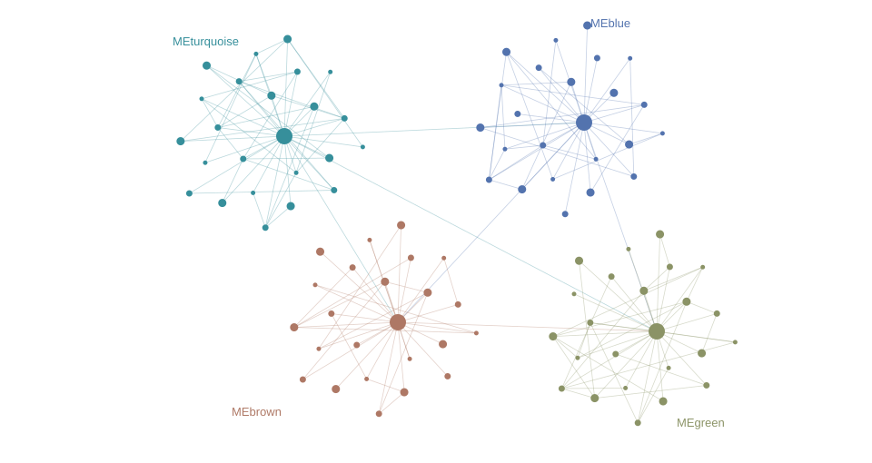

```{=html}
<aside class="rail"><a class="brand" href="../../index.html">rs<em>WGCNA</em><span style="font-size:10px;letter-spacing:0;margin-left:8px">REPORT</span></a><div class="eyebrow">Analysis record / 2026</div><nav><a href="#step-1" class="active"><span>01</span>Inputs & backgrounds</a><a href="#step-2" class=""><span>02</span>Final parameters</a><a href="#step-3" class=""><span>03</span>Filtering & sample QC</a><a href="#step-4" class=""><span>04</span>Soft threshold</a><a href="#step-5" class=""><span>05</span>Network & modules</a><a href="#step-6" class=""><span>06</span>Module–trait</a><a href="#step-7" class=""><span>07</span>Detail & enrichment</a><a href="#step-8" class=""><span>08</span>Hub genes</a><a href="#step-9" class=""><span>09</span>Files & reproducibility</a></nav><div class="rail-bottom">Design preview · synthetic data<a href="https://github.com/XiaoWang-SXAU-Lab/xiaowang-sxau-lab.github.io" target="_blank" rel="noopener">Xiao Wang Lab ↗</a><a href="../../DIRECTORY-STRUCTURE.md">Output directory specification</a></div></aside><main class="report"><div class="topline"><div class="eyebrow">Weighted gene co-expression network analysis</div><div class="actions"><a href="../../zh/report/index.html">中文</a><button data-print>Print / Save PDF</button></div></div><header class="hero"><div class="eyebrow">Arabidopsis · drought response · example project</div><h1>From expression<br>to connection.</h1><p>A traceable analysis record. Follow the inputs, filtering decisions and module analysis, with a practical guide to reading every figure.</p><div class="project-line">Arabidopsis_drought · 2026-10-27 14:30 +08:00 · rsWGCNA v0.5.0</div><div class="metrics"><div class="metric"><strong>18 → 17</strong><small>Input / retained samples</small></div><div class="metric"><strong>8,000</strong><small>Genes entering network</small></div><div class="metric"><strong>4</strong><small>Modules, excluding grey</small></div><div class="metric"><strong>30</strong><small>Displayed hub candidates</small></div></div></header><div class="notice">Style review sample: all numbers, figures, filenames and results are synthetic examples, not an analysis of existing data. The downloadable matrix contains only 8 rows to demonstrate the download experience. Production reports will use actual job results.</div><section class="step" id="step-1"><div class="step-head"><span class="step-no">01</span><h2>Inputs & backgrounds</h2></div><p class="step-intro">Start with the source data. All sample metadata are shown, along with the scope of annotation and background statistics.</p><div class="table-wrap"><table><thead><tr><th>Input</th><th>Filename (example)</th><th>Contents</th></tr></thead><tbody><tr ><td>Expression matrix</td><td>counts.tsv</td><td>18 samples × 24,000 genes; raw read counts</td></tr><tr ><td>Sample metadata</td><td>sample_info.tsv</td><td>18 rows; sample ID, genotype, condition, replicate</td></tr><tr ><td>Trait source</td><td>sample_info.tsv → condition</td><td>Selected trait column</td></tr><tr ><td>Gene annotation</td><td>annotation.tsv</td><td>24,000 unique genes; 21,300 with descriptions</td></tr><tr ><td>GO</td><td>gene2go.tsv</td><td>17,920 unique genes; 4,260 unique GO terms; 52,100 distinct mappings</td></tr><tr ><td>KEGG</td><td>gene2kegg.tsv</td><td>5,842 unique genes; 137 pathways; 12,640 distinct mappings</td></tr></tbody></table></div><h3>Complete sample metadata <span class="tag">18 rows</span></h3><input class="search" data-search aria-label="Search samples" placeholder="Search by sample ID, condition or genotype…"><div class="table-wrap"><table><thead><tr><th>Sample ID</th><th>Genotype</th><th>Condition</th><th>Replicate</th><th>Analysis status</th></tr></thead><tbody><tr data-sample ><td>WT_Control_r1</td><td>WT</td><td>Control</td><td>1</td><td>Retained</td></tr><tr data-sample ><td>WT_Control_r2</td><td>WT</td><td>Control</td><td>2</td><td>Retained</td></tr><tr data-sample ><td>WT_Control_r3</td><td>WT</td><td>Control</td><td>3</td><td>Retained</td></tr><tr data-sample ><td>Mut_Control_r1</td><td>Mut</td><td>Control</td><td>1</td><td>Retained</td></tr><tr data-sample ><td>Mut_Control_r2</td><td>Mut</td><td>Control</td><td>2</td><td>Retained</td></tr><tr data-sample ><td>Mut_Control_r3</td><td>Mut</td><td>Control</td><td>3</td><td>Retained</td></tr><tr data-sample ><td>WT_Drought_r1</td><td>WT</td><td>Drought</td><td>1</td><td>Retained</td></tr><tr data-sample ><td>WT_Drought_r2</td><td>WT</td><td>Drought</td><td>2</td><td>Retained</td></tr><tr data-sample ><td>WT_Drought_r3</td><td>WT</td><td>Drought</td><td>3</td><td>Retained</td></tr><tr data-sample ><td>Mut_Drought_r1</td><td>Mut</td><td>Drought</td><td>1</td><td>Retained</td></tr><tr data-sample ><td>Mut_Drought_r2</td><td>Mut</td><td>Drought</td><td>2</td><td>Retained</td></tr><tr data-sample class="removed"><td>Mut_Drought_r3</td><td>Mut</td><td>Drought</td><td>3</td><td>Excluded</td></tr><tr data-sample ><td>WT_Recovery_r1</td><td>WT</td><td>Recovery</td><td>1</td><td>Retained</td></tr><tr data-sample ><td>WT_Recovery_r2</td><td>WT</td><td>Recovery</td><td>2</td><td>Retained</td></tr><tr data-sample ><td>WT_Recovery_r3</td><td>WT</td><td>Recovery</td><td>3</td><td>Retained</td></tr><tr data-sample ><td>Mut_Recovery_r1</td><td>Mut</td><td>Recovery</td><td>1</td><td>Retained</td></tr><tr data-sample ><td>Mut_Recovery_r2</td><td>Mut</td><td>Recovery</td><td>2</td><td>Retained</td></tr><tr data-sample ><td>Mut_Recovery_r3</td><td>Mut</td><td>Recovery</td><td>3</td><td>Retained</td></tr></tbody></table></div><div class="caption">Table 1 · All 18 input rows are present. The highlighted row indicates a sample manually excluded later. IDs are preserved as uploaded. <a href="../result/01_input/sample_info.tsv" download>Download metadata</a></div><div class="reading">Count unique genes, unique terms and mapping rows separately. File coverage is different from the effective enrichment universe: production reports must also list the intersection with the analyzed gene set, unmatched IDs and duplicate mappings.</div></section><section class="step" id="step-2"><div class="step-head"><span class="step-no">02</span><h2>Final parameters</h2></div><p class="step-intro">Record the final parameters used by successful runs. The narrative explains decisions; the complete parameter tables support reproducibility.</p><details class="parameter" open><summary>Filtering</summary><div class="table-wrap"><table><thead><tr><th>Parameter</th><th>Final value</th></tr></thead><tbody><tr ><td>normalize_method</td><td>&quot;raw&quot;</td></tr><tr ><td>sample_percentage</td><td>0.5</td></tr><tr ><td>cutoff</td><td>10</td></tr><tr ><td>filter_method</td><td>&quot;mad&quot;</td></tr><tr ><td>n_keep</td><td>8000</td></tr><tr class="removed"><td>exclude_samples</td><td>[&quot;Mut_Drought_r3&quot;]</td></tr></tbody></table></div></details><details class="parameter" open><summary>Soft-threshold search</summary><div class="table-wrap"><table><thead><tr><th>Parameter</th><th>Final value</th></tr></thead><tbody><tr ><td>network_type</td><td>&quot;signed&quot;</td></tr><tr ><td>rsquared_cut</td><td>0.85</td></tr></tbody></table></div></details><details class="parameter" open><summary>Network construction</summary><div class="table-wrap"><table><thead><tr><th>Parameter</th><th>Final value</th></tr></thead><tbody><tr ><td>power</td><td>8</td></tr><tr ><td>network_type</td><td>&quot;signed&quot;</td></tr><tr ><td>tom_type</td><td>&quot;signed&quot;</td></tr><tr ><td>tom_denom</td><td>&quot;min&quot;</td></tr><tr ><td>min_module_size</td><td>30</td></tr><tr ><td>merge_cut_height</td><td>0.25</td></tr><tr ><td>deep_split</td><td>2</td></tr><tr ><td>detect_cut_height</td><td>0.995</td></tr></tbody></table></div></details><details class="parameter" open><summary>Module–trait</summary><div class="table-wrap"><table><thead><tr><th>Parameter</th><th>Final value</th></tr></thead><tbody><tr ><td>trait_source</td><td>&quot;sample_info&quot;</td></tr><tr ><td>trait_column</td><td>&quot;condition&quot;</td></tr></tbody></table></div></details><details class="parameter" open><summary>Module detail</summary><div class="table-wrap"><table><thead><tr><th>Parameter</th><th>Final value</th></tr></thead><tbody><tr ><td>select_module</td><td>&quot;turquoise&quot;</td></tr><tr ><td>select_trait</td><td>&quot;Drought&quot;</td></tr></tbody></table></div></details><details class="parameter" open><summary>Hub selection & network</summary><div class="table-wrap"><table><thead><tr><th>Parameter</th><th>Final value</th></tr></thead><tbody><tr ><td>select_module</td><td>&quot;turquoise&quot;</td></tr><tr ><td>select_trait</td><td>&quot;Drought&quot;</td></tr><tr ><td>kme_cutoff</td><td>0.8</td></tr><tr ><td>gs_cutoff</td><td>0.5</td></tr><tr ><td>weight_threshold</td><td>0.02</td></tr><tr ><td>power</td><td>8</td></tr><tr ><td>top_n_neighbors</td><td>20</td></tr><tr ><td>max_hubs</td><td>30</td></tr></tbody></table></div></details><div class="download-row"><a class="button" href="../result/00_provenance/parameters.final.json" download>Download all parameters</a><span class="muted">Example parameters; production export reads parameters used by each run, rather than unexecuted edits in the UI.</span></div></section><section class="step" id="step-3"><div class="step-head"><span class="step-no">03</span><h2>Filtering & sample QC</h2></div><p class="step-intro">Separate sample exclusion, low-expression filtering and variable-gene selection. These are distinct decisions.</p><div class="story"><p>The example starts with <strong>18 samples × 24,000 genes</strong>. The user manually excluded <strong>Mut_Drought_r3</strong>, leaving 17 samples. Raw read counts are used without transformation.</p></div><div class="story"><p>A gene is removed for low expression if its read count is below 10 in <strong>more than 50% of retained samples</strong>. With 17 samples, this means <strong>at least 9 samples</strong> below 10. This step removes 7,600 genes and leaves 16,400.</p></div><div class="story"><p>Next, 400 genes with no variation across samples are removed. The remaining genes are ranked by <strong>median absolute deviation (MAD)</strong>, which describes how much expression varies between samples. The top <strong>8,000 genes</strong> enter network analysis; another 8,000 are not selected. Genes outside the top set may still be biologically meaningful.</p></div><div class="flow"><div><small>Input</small><b>24,000</b><small>18 samples</small></div><span>→</span><div><small>After low-expression filter</small><b>16,400</b><small>17 samples</small></div><span>→</span><div><small>After constant-gene filter</small><b>16,000</b><small>MAD > 0</small></div><span>→</span><div><small>Network input</small><b>8,000</b><small>Top 8,000 by MAD</small></div></div><div class="table-wrap"><table><thead><tr><th>Excluded sample</th><th>Action</th><th>Reason</th></tr></thead><tbody><tr class="removed"><td>Mut_Drought_r3</td><td>Manually excluded</td><td>Not provided; no inferred quality issue</td></tr></tbody></table></div><div class="download-row"><a class="button primary" href="../result/02_filter/expression_filtered.preview.tsv" download>Download matrix sample · 8 rows</a><a href="../result/02_filter/removed_samples.tsv" download>Download exclusion log</a></div><p class="caption">Production export: result/02_filter/expression_filtered.tsv, containing the complete 8,000-gene × 17-sample matrix. The 8-row preview demonstrates the link only.</p><figure><figcaption><span><b>Figure 1.</b> Sample dendrogram before exclusion; annotation rows: condition, genotype.</span><a href="../result/02_filter/sample-tree.svg" download>Download SVG ↗</a></figcaption><div class="reading">How to read: nearby branches indicate more similar expression profiles. Annotation rows follow the selected order: condition, genotype, using the app default category palette. The red label marks a manual exclusion. This layout illustration cannot identify actual outliers. Production reports retain both before-exclusion and final trees, reusing the app leaf order, annotation rows, labels and colors.</div></figure></section><section class="step" id="step-4"><div class="step-head"><span class="step-no">04</span><h2>Soft threshold</h2></div><p class="step-intro">Inspect candidate values, then record the chosen power and the reason for choosing it.</p><div class="story"><p>This example uses a signed network with <strong>β = 8</strong>, the first illustrative candidate to reach R² ≥ 0.85. Power strengthens the contrast between stronger and weaker correlations. The production report also includes mean connectivity and scale-free diagnostic plots, and states whether power was recommended or manually chosen.</p></div><figure><figcaption><span><b>Figure 2.</b> Candidate powers and fit index (synthetic curve).</span><a href="../result/03_soft_threshold/soft-threshold.svg" download>Download SVG ↗</a></figcaption><div class="reading">How to read: candidate power is on the x-axis, fit index on the y-axis. The dashed line is the target; the brown point is the chosen power. Reaching the target alone does not establish network reliability.</div></figure></section><section class="step" id="step-5"><div class="step-head"><span class="step-no">05</span><h2>Network & modules</h2></div><p class="step-intro">Group genes with similar expression patterns and record unassigned genes.</p><div class="story"><p>Genes are clustered using topological overlap in a signed network. Minimum module size is 30; the module-merging distance threshold is 0.25. The example contains <strong>4 modules</strong> and <strong>200 unassigned grey genes</strong>; grey is excluded from the module count.</p></div><figure><figcaption><span><b>Figure 3.</b> Gene clustering and module assignments (illustration).</span><a href="../result/04_network/modules.svg" download>Download SVG ↗</a></figcaption><div class="reading">How to read: genes with the same assignment color belong to one module. Colors act as module names. Production export preserves the app pre/post-merge rows and their labels.</div></figure><div class="table-wrap"><table><thead><tr><th>Module</th><th>Gene count</th><th>Share of network input</th></tr></thead><tbody><tr ><td><span style="color:#368f9b">●</span> turquoise</td><td>2,700</td><td>33.75%</td></tr><tr ><td><span style="color:#5373ae">●</span> blue</td><td>2,200</td><td>27.50%</td></tr><tr ><td><span style="color:#ae7865">●</span> brown</td><td>1,800</td><td>22.50%</td></tr><tr ><td><span style="color:#8b9366">●</span> green</td><td>1,100</td><td>13.75%</td></tr><tr ><td><span style="color:#a1a6a3">●</span> grey</td><td>200</td><td>2.50%</td></tr></tbody></table></div></section><section class="step" id="step-6"><div class="step-head"><span class="step-no">06</span><h2>Module–trait</h2></div><p class="step-intro">Summarize module expression using its eigengene, then compare it with selected traits.</p><div class="story"><p>A module eigengene (ME) summarizes the main pattern of module expression; it is not a single representative gene. The heatmap shows ME–trait correlation. Actual results must also display p-values, the statistical test and whether multiple comparisons were adjusted.</p></div><figure><figcaption><span><b>Figure 4.</b> Module–trait heatmap; illustrative layout and color scale.</span><a href="../result/05_module_trait/module-trait.svg" download>Download SVG ↗</a></figcaption><div class="reading">How to read: red indicates positive correlation and blue negative correlation; deeper colors indicate larger absolute correlations. Correlation does not imply causation. This illustration has no actual p-values and makes no significance claims.</div></figure></section><section class="step" id="step-7"><div class="step-head"><span class="step-no">07</span><h2>Detail & enrichment</h2></div><p class="step-intro">Inspect gene-level patterns and functional context for the selected module and trait.</p><div class="download-row"><span class="pill">Selected module: turquoise</span><span class="pill">Selected trait: Drought</span></div><figure><figcaption><span><b>Figure 5.</b> GS versus module membership (synthetic points).</span><a href="../result/06_module_detail/turquoise/gs-mm.svg" download>Download SVG ↗</a></figcaption><div class="reading">How to read: each point is a gene. Larger |kME| indicates stronger alignment with the module; larger |GS| indicates stronger association with the trait. Dashed lines illustrate selection boundaries. Actual figures follow the app correlation direction, thresholds and axes.</div></figure><figure><figcaption><span><b>Figure 6.</b> GO enrichment dot plot (synthetic terms and values).</span><a href="../result/06_module_detail/turquoise/enrichment.svg" download>Download SVG ↗</a></figcaption><div class="reading">How to read: each row is a functional term; horizontal position indicates the selected-gene ratio. Actual dot size, color scale, adjusted p-values and GO/KEGG backgrounds follow app settings. This illustration makes no enrichment claims. Missing backgrounds, unrun analyses and no significant terms must be reported as distinct states.</div></figure></section><section class="step" id="step-8"><div class="step-head"><span class="step-no">08</span><h2>Hub genes</h2></div><p class="step-intro">Distinguish candidate selection from the displayed network size.</p><div class="story"><p>For turquoise and Drought, this example selects candidates using <strong>|kME| ≥ 0.8 and |GS| ≥ 0.5</strong>, yielding 42 illustrative candidates. The network displays at most 30 hubs, up to 20 neighbors per hub and edges with weight at least 0.02. Production reports must reflect the engine comparison operators, ranking and limits, and export all candidates as well as displayed nodes and edges.</p></div><figure><figcaption><span><b>Figure 7.</b> Network layout illustration; not actual module connections.</span><a href="../result/07_hub/turquoise/Drought/network.svg" download>Download SVG ↗</a></figcaption><div class="reading">How to read: nodes represent genes; edges represent co-expression links passing the threshold. This figure demonstrates visual style only. Production export uses the current app nodes, edges, positions, labels, sizes and colors to prevent random rearrangement.</div></figure></section><section class="step" id="step-9"><div class="step-head"><span class="step-no">09</span><h2>Files & reproducibility</h2></div><p class="step-intro">Keep figures, data and analysis settings within reach.</p><div class="table-wrap"><table><thead><tr><th>Contents</th><th>Path</th><th>Purpose</th></tr></thead><tbody><tr ><td>HTML</td><td>report/index.html</td><td>Report entry in the chosen language</td></tr><tr ><td>Quarto</td><td>report/report.qmd</td><td>Editable, re-renderable report source</td></tr><tr ><td>Figures & tables</td><td>result/01_input/ … 07_hub/</td><td>Organized by report step</td></tr><tr ><td>Reading guide</td><td>result/README.txt</td><td>File index, columns and interpretation</td></tr><tr ><td>Analysis provenance</td><td>result/00_provenance/</td><td>Final parameters, view state, environment and checksums</td></tr></tbody></table></div><div class="download-row"><a class="button" href="../result/README.txt" download>Download reading guide</a><a href="../result/00_provenance/view-state.json" download>Example view snapshot</a><a href="report.qmd" download>Download Quarto source</a></div><div class="reading">This preview uses local SVG, CSS and JavaScript, with no external fonts or chart CDN. Copy the complete project folder to open report/index.html offline. Production export follows the current app language, generating separate Chinese or English reports.</div></section><footer class="footer"><span>© 2026 Xiao Wang Lab · rsWGCNA</span><span><a href="https://github.com/XiaoWang-SXAU-Lab/xiaowang-sxau-lab.github.io" target="_blank" rel="noopener">Lab homepage (GitHub) ↗</a> · Design preview v2</span></footer></main>
```
