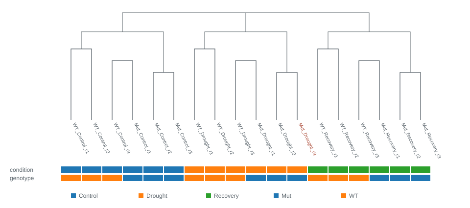
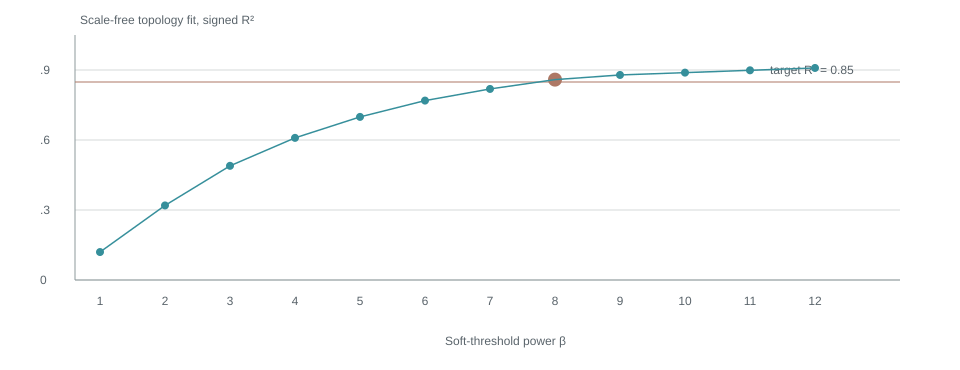
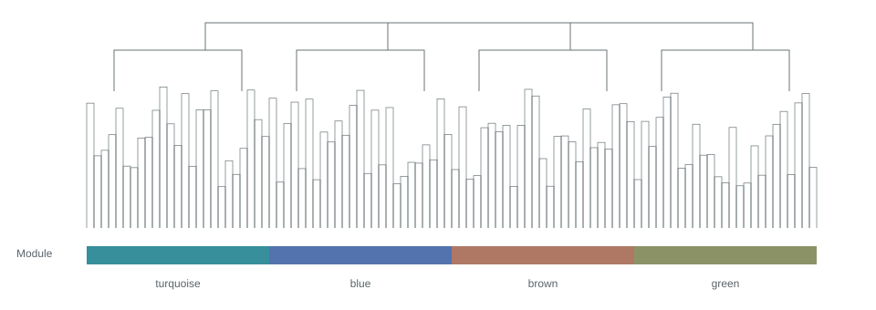
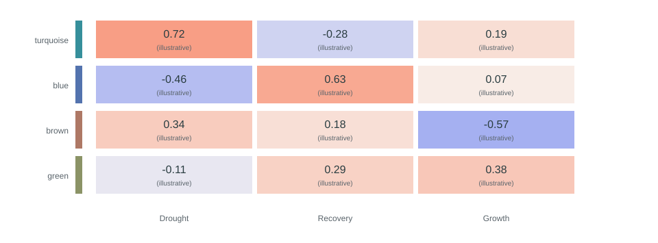
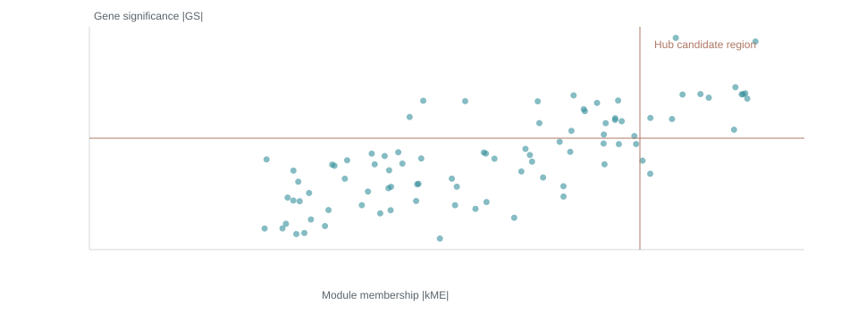
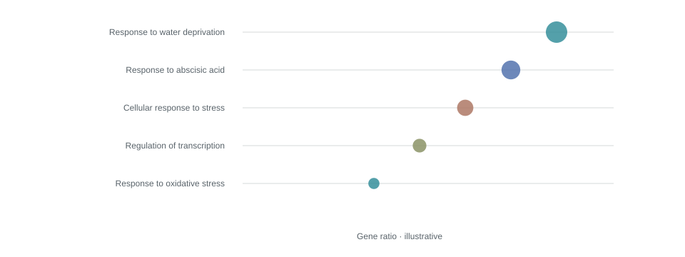

```{=html}
<aside class="rail"><a class="brand" href="../../index.html">rs<em>WGCNA</em><span style="font-size:10px;letter-spacing:0;margin-left:8px">REPORT</span></a><div class="eyebrow">分析记录 / 2026</div><nav><a href="#step-1" class="active"><span>01</span>输入与背景</a><a href="#step-2" class=""><span>02</span>最终参数</a><a href="#step-3" class=""><span>03</span>过滤与样本质控</a><a href="#step-4" class=""><span>04</span>软阈值选择</a><a href="#step-5" class=""><span>05</span>网络与模块</a><a href="#step-6" class=""><span>06</span>模块与性状</a><a href="#step-7" class=""><span>07</span>模块深入与富集</a><a href="#step-8" class=""><span>08</span>Hub 基因</a><a href="#step-9" class=""><span>09</span>文件与复现</a></nav><div class="rail-bottom">设计预览 · 全部为模拟数据<a href="https://github.com/XiaoWang-SXAU-Lab/xiaowang-sxau-lab.github.io" target="_blank" rel="noopener">Xiao Wang Lab ↗</a><a href="../../DIRECTORY-STRUCTURE.md">查看输出目录方案</a></div></aside><main class="report"><div class="topline"><div class="eyebrow">加权基因共表达网络分析</div><div class="actions"><a href="../../en/report/index.html">English</a><button data-print>打印 / 保存 PDF</button></div></div><header class="hero"><div class="eyebrow">拟南芥 · 干旱应答 · 示例项目</div><h1>从表达矩阵，<br>到共表达网络。</h1><p>一份可追溯的分析记录。从输入文件、数据筛选到模块解析，逐步说明本次分析做了什么，以及每张图应该怎么看。</p><div class="project-line">Arabidopsis_drought · 2026-10-27 14:30 +08:00 · rsWGCNA v0.5.0</div><div class="metrics"><div class="metric"><strong>18 → 17</strong><small>输入 / 保留样本</small></div><div class="metric"><strong>8,000</strong><small>进入网络的基因</small></div><div class="metric"><strong>4</strong><small>共表达模块（不含 grey）</small></div><div class="metric"><strong>30</strong><small>展示的 Hub 候选</small></div></div></header><div class="notice">风格审阅样张：本页数字、图表、文件名和结果均为模拟示例，不代表对现有数据的分析。可下载的矩阵只含 8 行，用于检验下载体验。正式报告将替换为本次任务的真实结果。</div><section class="step" id="step-1"><div class="step-head"><span class="step-no">01</span><h2>输入与背景</h2></div><p class="step-intro">先记录分析从哪里开始。样本信息完整展示，并保留输入文件与注释背景的统计口径。</p><div class="table-wrap"><table><thead><tr><th>输入文件</th><th>文件名（示例）</th><th>内容</th></tr></thead><tbody><tr ><td>表达矩阵</td><td>counts.tsv</td><td>18 样本 × 24,000 基因；原始 read count</td></tr><tr ><td>样本信息</td><td>sample_info.tsv</td><td>18 行；样本 ID、基因型、条件、重复</td></tr><tr ><td>性状来源</td><td>sample_info.tsv → condition</td><td>本次选择的性状列</td></tr><tr ><td>基因注释</td><td>annotation.tsv</td><td>24,000 个唯一基因；21,300 个具有描述</td></tr><tr ><td>GO</td><td>gene2go.tsv</td><td>17,920 个唯一基因；4,260 个唯一 GO term；52,100 条去重映射</td></tr><tr ><td>KEGG</td><td>gene2kegg.tsv</td><td>5,842 个唯一基因；137 条通路；12,640 条去重映射</td></tr></tbody></table></div><h3>完整样本信息 <span class="tag">18 行</span></h3><input class="search" data-search aria-label="搜索样本" placeholder="搜索样本 ID、条件或基因型…"><div class="table-wrap"><table><thead><tr><th>样本 ID</th><th>基因型</th><th>条件</th><th>重复</th><th>分析状态</th></tr></thead><tbody><tr data-sample ><td>WT_Control_r1</td><td>WT</td><td>Control</td><td>1</td><td>保留</td></tr><tr data-sample ><td>WT_Control_r2</td><td>WT</td><td>Control</td><td>2</td><td>保留</td></tr><tr data-sample ><td>WT_Control_r3</td><td>WT</td><td>Control</td><td>3</td><td>保留</td></tr><tr data-sample ><td>Mut_Control_r1</td><td>Mut</td><td>Control</td><td>1</td><td>保留</td></tr><tr data-sample ><td>Mut_Control_r2</td><td>Mut</td><td>Control</td><td>2</td><td>保留</td></tr><tr data-sample ><td>Mut_Control_r3</td><td>Mut</td><td>Control</td><td>3</td><td>保留</td></tr><tr data-sample ><td>WT_Drought_r1</td><td>WT</td><td>Drought</td><td>1</td><td>保留</td></tr><tr data-sample ><td>WT_Drought_r2</td><td>WT</td><td>Drought</td><td>2</td><td>保留</td></tr><tr data-sample ><td>WT_Drought_r3</td><td>WT</td><td>Drought</td><td>3</td><td>保留</td></tr><tr data-sample ><td>Mut_Drought_r1</td><td>Mut</td><td>Drought</td><td>1</td><td>保留</td></tr><tr data-sample ><td>Mut_Drought_r2</td><td>Mut</td><td>Drought</td><td>2</td><td>保留</td></tr><tr data-sample class="removed"><td>Mut_Drought_r3</td><td>Mut</td><td>Drought</td><td>3</td><td>已排除</td></tr><tr data-sample ><td>WT_Recovery_r1</td><td>WT</td><td>Recovery</td><td>1</td><td>保留</td></tr><tr data-sample ><td>WT_Recovery_r2</td><td>WT</td><td>Recovery</td><td>2</td><td>保留</td></tr><tr data-sample ><td>WT_Recovery_r3</td><td>WT</td><td>Recovery</td><td>3</td><td>保留</td></tr><tr data-sample ><td>Mut_Recovery_r1</td><td>Mut</td><td>Recovery</td><td>1</td><td>保留</td></tr><tr data-sample ><td>Mut_Recovery_r2</td><td>Mut</td><td>Recovery</td><td>2</td><td>保留</td></tr><tr data-sample ><td>Mut_Recovery_r3</td><td>Mut</td><td>Recovery</td><td>3</td><td>保留</td></tr></tbody></table></div><div class="caption">表 1 · 原始上传的 18 行均在此处；红色行表示后续手动排除的样本。样本 ID 与文件中的内容保持原样。 <a href="../result/01_input/sample_info.tsv" download>下载样本表</a></div><div class="reading">背景文件的“唯一基因数”“唯一条目数”和“映射行数”分别统计。GO/KEGG 文件覆盖量不等于富集分析实际背景：正式报告还需列出所选背景与进入分析基因集的交集大小、未匹配 ID 和重复映射数。</div></section><section class="step" id="step-2"><div class="step-head"><span class="step-no">02</span><h2>最终参数</h2></div><p class="step-intro">这里记录实际运行成功的最终参数。正文解释分析决策，完整参数表用于复查与复现。</p><details class="parameter" open><summary>清洗过滤</summary><div class="table-wrap"><table><thead><tr><th>参数</th><th>最终值</th></tr></thead><tbody><tr ><td>normalize_method</td><td>&quot;raw&quot;</td></tr><tr ><td>sample_percentage</td><td>0.5</td></tr><tr ><td>cutoff</td><td>10</td></tr><tr ><td>filter_method</td><td>&quot;mad&quot;</td></tr><tr ><td>n_keep</td><td>8000</td></tr><tr class="removed"><td>exclude_samples</td><td>[&quot;Mut_Drought_r3&quot;]</td></tr></tbody></table></div></details><details class="parameter" open><summary>软阈值搜索</summary><div class="table-wrap"><table><thead><tr><th>参数</th><th>最终值</th></tr></thead><tbody><tr ><td>network_type</td><td>&quot;signed&quot;</td></tr><tr ><td>rsquared_cut</td><td>0.85</td></tr></tbody></table></div></details><details class="parameter" open><summary>网络构建</summary><div class="table-wrap"><table><thead><tr><th>参数</th><th>最终值</th></tr></thead><tbody><tr ><td>power</td><td>8</td></tr><tr ><td>network_type</td><td>&quot;signed&quot;</td></tr><tr ><td>tom_type</td><td>&quot;signed&quot;</td></tr><tr ><td>tom_denom</td><td>&quot;min&quot;</td></tr><tr ><td>min_module_size</td><td>30</td></tr><tr ><td>merge_cut_height</td><td>0.25</td></tr><tr ><td>deep_split</td><td>2</td></tr><tr ><td>detect_cut_height</td><td>0.995</td></tr></tbody></table></div></details><details class="parameter" open><summary>模块与性状</summary><div class="table-wrap"><table><thead><tr><th>参数</th><th>最终值</th></tr></thead><tbody><tr ><td>trait_source</td><td>&quot;sample_info&quot;</td></tr><tr ><td>trait_column</td><td>&quot;condition&quot;</td></tr></tbody></table></div></details><details class="parameter" open><summary>模块深入</summary><div class="table-wrap"><table><thead><tr><th>参数</th><th>最终值</th></tr></thead><tbody><tr ><td>select_module</td><td>&quot;turquoise&quot;</td></tr><tr ><td>select_trait</td><td>&quot;Drought&quot;</td></tr></tbody></table></div></details><details class="parameter" open><summary>Hub 筛选与网络</summary><div class="table-wrap"><table><thead><tr><th>参数</th><th>最终值</th></tr></thead><tbody><tr ><td>select_module</td><td>&quot;turquoise&quot;</td></tr><tr ><td>select_trait</td><td>&quot;Drought&quot;</td></tr><tr ><td>kme_cutoff</td><td>0.8</td></tr><tr ><td>gs_cutoff</td><td>0.5</td></tr><tr ><td>weight_threshold</td><td>0.02</td></tr><tr ><td>power</td><td>8</td></tr><tr ><td>top_n_neighbors</td><td>20</td></tr><tr ><td>max_hubs</td><td>30</td></tr></tbody></table></div></details><div class="download-row"><a class="button" href="../result/00_provenance/parameters.final.json" download>下载完整参数 JSON</a><span class="muted">示例参数；正式导出读取各步骤实际使用的参数，而非尚未运行的界面值。</span></div></section><section class="step" id="step-3"><div class="step-head"><span class="step-no">03</span><h2>过滤与样本质控</h2></div><p class="step-intro">明确区分样本删除、低表达过滤和高变基因选择，避免把所有减少都归因于“噪音”。</p><div class="story"><p>本例从 <strong>18 个样本 × 24,000 个基因</strong>开始。用户手动排除了 <strong>Mut_Drought_r3</strong>，剩余 17 个样本。本例选择保留原始 read count，不做数值转换。</p></div><div class="story"><p>如果一个基因在<strong>超过 50% 的保留样本</strong>中 read count 小于 10，就因低表达被去除。对于本例的 17 个样本，这意味着<strong>至少 9 个样本</strong>低于 10 才会被过滤。这个步骤去掉 7,600 个基因，留下 16,400 个。</p></div><div class="story"><p>随后去掉样本间表达完全不变的 400 个基因，再按照<strong>中位数绝对离差（MAD）</strong>从大到小排序。MAD 描述一个基因在不同样本之间的表达波动；本例保留排名前 <strong>8,000</strong> 个基因进入后续网络分析，其余 8,000 个未入选。未入选不等于这些基因没有生物学意义。</p></div><div class="flow"><div><small>输入</small><b>24,000</b><small>18 个样本</small></div><span>→</span><div><small>去低表达后</small><b>16,400</b><small>17 个样本</small></div><span>→</span><div><small>去零变异后</small><b>16,000</b><small>MAD > 0</small></div><span>→</span><div><small>用于建网</small><b>8,000</b><small>MAD 排名前 8,000</small></div></div><div class="table-wrap"><table><thead><tr><th>删除的样本</th><th>操作</th><th>原因</th></tr></thead><tbody><tr class="removed"><td>Mut_Drought_r3</td><td>用户手动排除</td><td>未填写；不推测质量问题</td></tr></tbody></table></div><div class="download-row"><a class="button primary" href="../result/02_filter/expression_filtered.preview.tsv" download>下载矩阵示例 · 8 行</a><a href="../result/02_filter/removed_samples.tsv" download>下载删除记录</a></div><p class="caption">正式导出：result/02_filter/expression_filtered.tsv，保存完整的 8,000 基因 × 17 样本矩阵。本样张的 8 行文件仅演示链接，不冒充完整结果。</p><figure><figcaption><span><b>图 1.</b> 样本聚类树 · 删除前视图；底部色带为 condition、genotype。</span><a href="../result/02_filter/sample-tree.svg" download>下载 SVG ↗</a></figcaption><div class="reading">怎么看：相邻分支表示表达模式更相似。色带从上到下严格使用用户选择的 condition、genotype；类别使用 app 默认调色板。红色标签标识手动排除项。此图为布局示意，不能据此判断真实离群样本。正式报告同时保留删除前和最终样本树，并复用 app 的叶序、色带、标签和颜色。</div></figure></section><section class="step" id="step-4"><div class="step-head"><span class="step-no">04</span><h2>软阈值选择</h2></div><p class="step-intro">先观察候选值，再记录最终采用值及其选择依据。</p><div class="story"><p>本例使用 signed 网络，选择 <strong>β = 8</strong>。示例拟合曲线在此首次达到 R² ≥ 0.85。软阈值会放大较强相关、减弱较弱相关；正式报告需同时展示平均连通性及 scale-free 检验，并说明 β 是自动推荐还是用户指定。</p></div><figure><figcaption><span><b>图 2.</b> 软阈值候选与拟合指标（模拟曲线）。</span><a href="../result/03_soft_threshold/soft-threshold.svg" download>下载 SVG ↗</a></figcaption><div class="reading">怎么看：横轴是候选 β，纵轴是拟合指标。虚线是本次目标线，棕色点是采用值。达到目标线只是选参依据之一，不能单独证明网络可靠。</div></figure></section><section class="step" id="step-5"><div class="step-head"><span class="step-no">05</span><h2>网络与模块</h2></div><p class="step-intro">将表达模式相似的基因分组，并记录未分配基因。</p><div class="story"><p>本例根据 signed 网络的拓扑重叠关系聚类，再识别基因模块。最小模块大小设为 30，模块合并距离阈值为 0.25。示例最终有 <strong>4 个模块</strong>，另有 <strong>200 个 grey 基因</strong>未分配到模块；grey 不计入模块总数。</p></div><figure><figcaption><span><b>图 3.</b> 基因聚类与模块色带（示意图）。</span><a href="../result/04_network/modules.svg" download>下载 SVG ↗</a></figcaption><div class="reading">怎么看：下方同色区域表示同一模块，模块色仅作名称标识。正式报告保留 app 中展示的合并前 / 合并后色带及其原始标签，不重新命名。</div></figure><div class="table-wrap"><table><thead><tr><th>模块</th><th>基因数</th><th>占建网基因比例</th></tr></thead><tbody><tr ><td><span style="color:#368f9b">●</span> turquoise</td><td>2,700</td><td>33.75%</td></tr><tr ><td><span style="color:#5373ae">●</span> blue</td><td>2,200</td><td>27.50%</td></tr><tr ><td><span style="color:#ae7865">●</span> brown</td><td>1,800</td><td>22.50%</td></tr><tr ><td><span style="color:#8b9366">●</span> green</td><td>1,100</td><td>13.75%</td></tr><tr ><td><span style="color:#a1a6a3">●</span> grey</td><td>200</td><td>2.50%</td></tr></tbody></table></div></section><section class="step" id="step-6"><div class="step-head"><span class="step-no">06</span><h2>模块与性状</h2></div><p class="step-intro">用模块特征向量概括模块表达，再与所选性状比较。</p><div class="story"><p>模块特征向量（ME）是模块表达的主要变化模式，并不是某一个“代表基因”。热图展示 ME 与性状的相关系数；正式结果还需显示 p 值，并标明检验方法和是否校正多重比较。</p></div><figure><figcaption><span><b>图 4.</b> 模块–性状相关热图；仅示范布局与色阶。</span><a href="../result/05_module_trait/module-trait.svg" download>下载 SVG ↗</a></figcaption><div class="reading">怎么看：红色偏正相关，蓝色偏负相关，颜色越深表示绝对相关越强。相关性不代表因果关系。这个示意图没有真实 p 值，也不作显著性结论。</div></figure></section><section class="step" id="step-7"><div class="step-head"><span class="step-no">07</span><h2>模块深入与富集</h2></div><p class="step-intro">围绕用户选定的模块与性状，整理基因表现与功能线索。</p><div class="download-row"><span class="pill">所选模块: turquoise</span><span class="pill">所选性状: Drought</span></div><figure><figcaption><span><b>图 5.</b> GS 与模块隶属度散点（模拟点）。</span><a href="../result/06_module_detail/turquoise/gs-mm.svg" download>下载 SVG ↗</a></figcaption><div class="reading">怎么看：每个点是一个基因。|kME| 越大，表达模式与模块越一致；|GS| 越大，与目标性状的关联越强。虚线示范候选筛选边界，正式图使用当前 app 的相关方向、阈值与坐标设置。</div></figure><figure><figcaption><span><b>图 6.</b> GO 富集气泡图（模拟术语与数值）。</span><a href="../result/06_module_detail/turquoise/enrichment.svg" download>下载 SVG ↗</a></figcaption><div class="reading">怎么看：每一行是一个功能条目，点的位置表示入选基因比例。正式图的点大小、色阶、校正后 p 值及 GO / KEGG 背景均按 app 当前设置导出；此示意图不作富集结论。未提供背景、未运行或无显著条目时，报告应明确标明对应状态。</div></figure></section><section class="step" id="step-8"><div class="step-head"><span class="step-no">08</span><h2>Hub 基因</h2></div><p class="step-intro">把“候选筛选”与“网络展示”分开记录，避免将展示数量误作全部候选数量。</p><div class="story"><p>本例在 turquoise 模块、Drought 性状下，用 <strong>|kME| ≥ 0.8、|GS| ≥ 0.5</strong>作为筛选条件，示例有 42 个候选。网络最多展示 30 个 Hub，每个最多保留 20 个邻居，边权重下限为 0.02。正式报告以引擎实际采用的比较符号、排序和截断规则为准，并导出全部候选与最终展示的节点 / 边。</p></div><figure><figcaption><span><b>图 7.</b> 网络排版示意；不代表本模块真实连接。</span><a href="../result/07_hub/turquoise/Drought/network.svg" download>下载 SVG ↗</a></figcaption><div class="reading">怎么看：节点表示基因，连线表示通过阈值的共表达关系。此图仅供审阅视觉风格；正式报告使用 app 的当前网络节点、边、位置、标签、大小及颜色，避免导出时随机重排。</div></figure></section><section class="step" id="step-9"><div class="step-head"><span class="step-no">09</span><h2>文件与复现</h2></div><p class="step-intro">让阅读报告的人能回到原始图表、数据和分析设定。</p><div class="table-wrap"><table><thead><tr><th>内容</th><th>路径</th><th>说明</th></tr></thead><tbody><tr ><td>HTML</td><td>report/index.html</td><td>本语言的报告入口</td></tr><tr ><td>Quarto</td><td>report/report.qmd</td><td>可重新编译的报告源文件</td></tr><tr ><td>全部图表与表格</td><td>result/01_input/ … 07_hub/</td><td>按报告步骤编号归档</td></tr><tr ><td>读图说明</td><td>result/README.txt</td><td>文件索引、字段和读图方法</td></tr><tr ><td>分析记录</td><td>result/00_provenance/</td><td>最终参数、视图快照、环境和文件校验</td></tr></tbody></table></div><div class="download-row"><a class="button" href="../result/README.txt" download>下载读图说明</a><a href="../result/00_provenance/view-state.json" download>查看视图快照示例</a><a href="report.qmd" download>下载 Quarto 源文件</a></div><div class="reading">本预览使用项目内的 SVG、CSS 和 JavaScript，无在线字体或图表 CDN。完整复制项目文件夹后即可离线打开 report/index.html。正式导出默认使用 app 当前语言；中文和英文是分别生成的报告，不在一个报告里混排。</div></section><footer class="footer"><span>© 2026 Xiao Wang Lab · rsWGCNA</span><span><a href="https://github.com/XiaoWang-SXAU-Lab/xiaowang-sxau-lab.github.io" target="_blank" rel="noopener">课题组主页（GitHub） ↗</a> · 设计预览 v2</span></footer></main>
```
